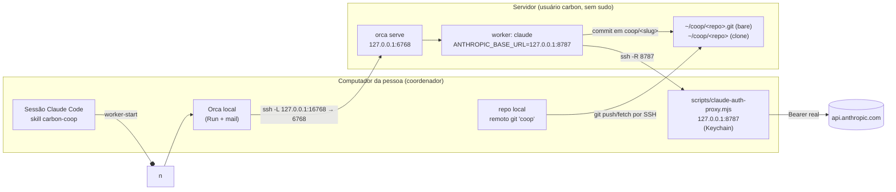

# Skill "trabalho cooperativo" — Design

**Spec**: `.specs/features/coop-skill/spec.md` · **Contexto**: `context.md`
**Status**: Draft

## Arquitetura

Uma conexão SSH (`coop-tunnel`) carrega os dois túneis. O git usa o SSH normal (mesma chave), separado do túnel.

## Fluxo P1

1. **preflight** (`scripts/preflight.sh`): checa macOS, `orca`, `ssh -o BatchMode=yes`, `git`, `node≥22`, item
   "Claude Code-credentials" existe (`security find-generic-password -s ... ` **sem** `-w`), versão do Orca local. Saída JSON.
2. **prepare-server** (`scripts/prepare-server.sh`, roda via `ssh root@` **só com confirmação**): cria `carbon`,
   instala Node (na home), Claude Code, Orca headless (Q1), grava `~carbon/.claude/settings.json` com
   `env.ANTHROPIC_BASE_URL` e token placeholder (Q2). Idempotente; imprime o que fez.
3. **proxy**: `node <skill>/scripts/claude-auth-proxy.mjs --from-claude-login` em background (se `127.0.0.1:8787` já responde, reaproveita). PID em `~/.carbon-coop/<srv>/proxy.pid`.
4. **tunnel**: `ssh -N -o BatchMode=yes -o ExitOnForwardFailure=yes -o ServerAliveInterval=20 -R 127.0.0.1:8787:127.0.0.1:8787 -L 127.0.0.1:16768:127.0.0.1:6768 carbon@host`.
5. **serve + pair** (`scripts/pair.sh`): sobe `orca-ide serve --bind 127.0.0.1 --pairing-address 127.0.0.1:16768 --json`
   no servidor (systemd user ou nohup), extrai o code e faz, num único pipe,
   `orca environment add --name <srv> --pairing-code "$(ssh … | jq -r .pairingCode)"`. O code nunca é ecoado (COOP-07).
6. **smoke**: `worker-start --on <srv> --spec "responda ok e chame worker_done"`; espera o wake.
7. **dispatch**: `git remote add coop carbon@host:coop/<repo>.git` (cria bare se faltar), `git push coop HEAD:refs/heads/coop/base-<slug>`,
   no servidor `git -C ~/coop/<repo> fetch` + `orca repo add --environment <srv> --path /home/carbon/coop/<repo>` (uma vez),
   `worker-start --on <srv> --worktree new-top-level --repo path:/home/carbon/coop/<repo> --base-branch coop/base-<slug> --name coop-<slug> --agent claude --spec-file -`.
   Encerra o turno; o Orca acorda a sessão.
8. **collect**: no `worker_done`, o worker já fez `git push origin HEAD:coop/<slug>` para o bare (instrução da spec);
   local `git fetch coop coop/<slug>`, `git diff --stat HEAD...FETCH_HEAD`, oferece revisar/mesclar/descartar.
9. **disconnect**: lista workers ativos (`orca orchestration worker-list`), confirma, mata túnel e proxy pelos PIDs.

## Componentes

| Componente | Local | Papel | Reusa |
| --- | --- | --- | --- |
| `SKILL.md` | `skills/carbon-coop/` | Gatilhos, regras de segurança, fluxo connect/dispatch/status/disconnect, quando perguntar | Padrão de skills do Claude Code |
| `references/security.md` | idem | O que nunca fazer (senha, code no chat, sudo, repos bloqueados) | `docs/distributed/ssh-tunnel-shared-claude.md` (riscos) |
| `scripts/preflight.sh` | idem | Checagens locais/remotas, saída JSON | — |
| `references/server-setup.md` | idem | Usuário, Node, Claude Code, Orca, settings.json (manual, com confirmação) | Seção 1 do doc de túnel |
| `scripts/proxy.sh`, `scripts/serve.sh`, `scripts/init.sh`, `scripts/lib.sh` | idem | Proxy local, `orca-ide serve` remoto, perfil 0600 | — |
| `scripts/tunnel.sh` | idem | start/stop/status do túnel com PID file | Comando de túnel já validado |
| `scripts/pair.sh` | idem | serve remoto + pareamento sem vazar o code | — |
| `scripts/code-sync.sh` | idem | bare remoto, push base, fetch resultado | Ideia do transporte do Carbon (`prepare-claim.ts`) |
| `templates/worker-spec.md` | idem | Spec enviada ao worker (objetivo, critério, commit/push no bare, sem infra) | `src/server/runner/prompt.ts` (tom e regras) |
| Proxy | `skills/carbon-coop/scripts/claude-auth-proxy.mjs` | Cópia do `bin/claude-auth-proxy.mjs` (só módulos nativos); teste garante que as duas cópias são iguais | já testado |
| Plugin manifest | `.claude-plugin/plugin.json` | Instalar a skill pelo repo | — |

Estado local por servidor: `~/.carbon-coop/<srv>/{config.json,tunnel.pid,proxy.pid}` (0700). `config.json` guarda host,
portas, nome do environment — nenhum segredo. `blockedRepos` em `~/.carbon-coop/config.json`.

## Tratamento de erros

| Cenário | Tratamento | O que a pessoa vê |
| --- | --- | --- |
| SSH pede senha | `BatchMode=yes` falha rápido | "Configure chave: `ssh-copy-id …`" |
| Porta ocupada | `lsof -iTCP:
`; escolhe próxima livre | Porta usada e quem ocupa |
| Keychain negado | Proxy não sobe | "Clique Permitir sempre e rode de novo" |
| `orca serve` exit 3 | Para | "Já existe Orca neste perfil no servidor" |
| `worker-start` falha | Não repetir; ler `failedStage` (guia recovery) | Estágio e próximo passo |
| Escalation | Mostra `stopReason` | Reenviar / `send` / cancelar |
| Fetch sem branch | Worker não fez push | Pede ao worker via `send` ou lê `worker-read` |
| 5xx do proxy prolongado | Túnel caiu ou login vencido | `status` aponta qual |

## Decisões técnicas

| Decisão | Escolha | Motivo |
| --- | --- | --- |
| Credencial do Claude no servidor | Proxy local via `-R` | Já validado; credencial nunca sai do Mac |
| Runtime Orca | `--bind 127.0.0.1` + `ssh -L` | Nenhuma porta pública; SSH cifra |
| Código | Bare repo por SSH, só commitado | Sem depender de GitHub; mesma regra do Carbon |
| Resultado | Branch `coop/<slug>` no bare → fetch | Revisão local; sem push em remoto de terceiros |
| Lógica em scripts shell, não no prompt | Scripts idempotentes com saída JSON | Determinístico, testável, menos token |
| Guia do Orca | Carregado em runtime (`orca skills get`) | Fica alinhado à versão instalada |

## Mitigações de CONCERNS / riscos

- **Root no servidor usa a conta enquanto ligado** (mesmo risco do doc de túnel): `disconnect` explícito, `status` mostra chamadas do proxy.
- **Código vai para o servidor**: `blockedRepos` + aviso no primeiro despacho de cada repo.
- **Q4 (permissões remotas)**: até o spike responder, spec do worker roda com perfil de permissões restrito e instrução de `ask` antes de comando fora do repo.
