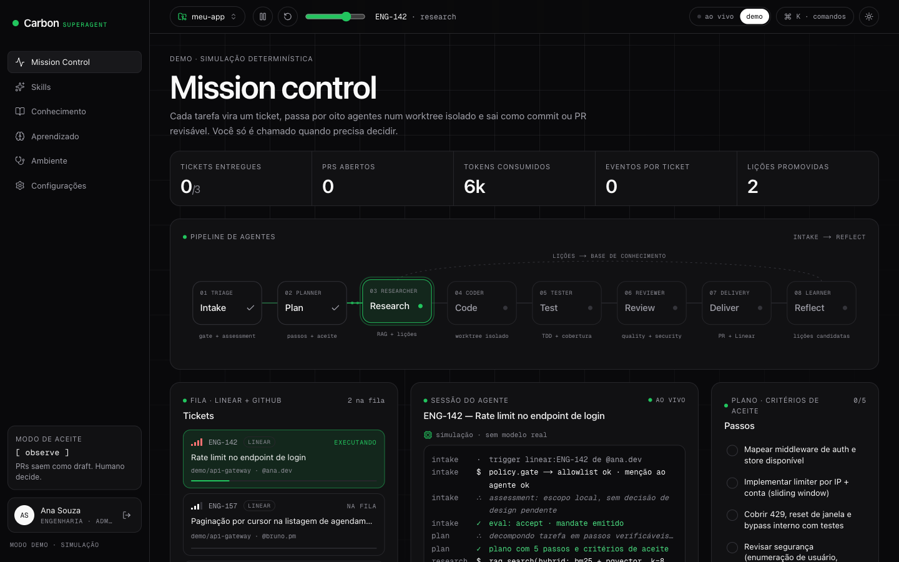
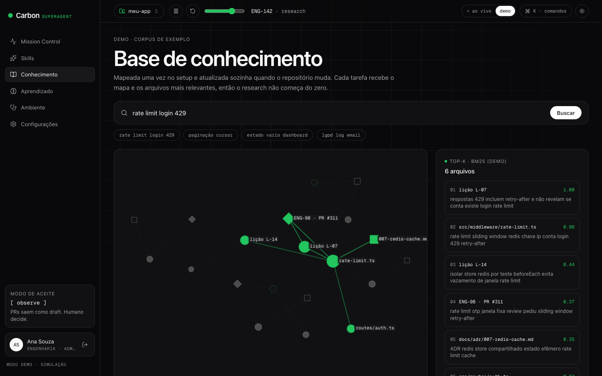
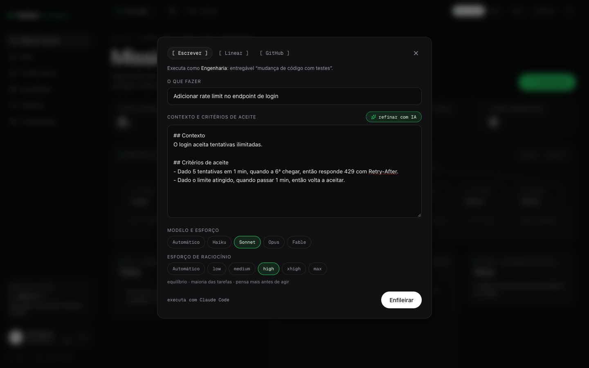

# Carbon SuperAgent

Agentes autônomos que pegam uma tarefa do **Linear**, do **GitHub** ou escrita à mão e entregam um commit/PR revisável — rodando no **seu computador**, com o **Claude Code** ou o **Codex** do seu plano. Sem API key extra.

```
tarefa → intake → plan → research → code → test → review → deliver → reflect
          (worktree isolado por tarefa · você só é chamado quando precisa decidir)
```

**Site:** LANDING_URL · **Licença:** MIT



<table><tr>
<td></td>
<td></td>
</tr></table>

## Inspiração

O Carbon nasceu da filosofia do [**deepseek-ai/dsh-superagent-prototype**](https://github.com/deepseek-ai/dsh-superagent-prototype): um agente que leva a tarefa de ponta a ponta, com etapas explícitas (intake, plano, pesquisa, código, teste, revisão, entrega, reflexão), memória e autoaprendizado, e que só chama o humano quando há uma decisão a tomar. *Menos atenção humana, mais valor entregue.*

Aqui essa ideia virou uma plataforma web local:

- em vez de um protótipo de linha de comando, um painel com o pipeline, a sessão do agente e o plano ao vivo;
- em vez de um modelo próprio, os agentes de código que você já paga: **Claude Code** ou **Codex**;
- ligada ao seu **Linear** e ao seu **GitHub**, com uma base de conhecimento por repositório e lições que você promove.

Projeto independente, sem afiliação com DeepSeek, Anthropic, OpenAI ou Agno.

## Começar em 2 minutos

Requisitos: **Node 22.13+**, **git** e **um** agente logado: **Claude Code** ou **Codex** (não precisa dos dois; com os dois, você escolhe por tarefa).

```sh
git clone https://github.com/leolegends/carbon-superagent.git && cd carbon-superagent
npm install
npm run setup
```

O `setup` verifica a máquina, oferece instalar o agente que faltar, compila o painel e abre o navegador num assistente que cria seu perfil de admin, escolhe o agente e o repositório. Depois:

```sh
npm start        # sobe o painel em http://localhost:3417
npm run doctor   # diagnóstico do ambiente
```

> Só quer olhar? No painel, troque para **demo** no topo: simulação completa sem rodar nada.

## Como funciona

| Peça | O que faz |
| --- | --- |
| **Executores** | `claude -p … --output-format stream-json` ou `codex exec --json`. Cada CLI usa o login que já existe no seu computador; o Carbon nunca lê esses tokens. |
| **Worktree por tarefa** | Cada tarefa roda em `.carbon-data/worktrees/<tarefa>` no branch `agent/<tarefa>`. Seu branch atual nunca é tocado. |
| **Protocolo de progresso** | O agente imprime `CARBON_STAGE`, `CARBON_PLAN`, `CARBON_TESTS`, `CARBON_FINDING`, `CARBON_LESSON`, `CARBON_QUESTION`; o painel transforma isso em pipeline, plano, testes e review ao vivo. |
| **Entrega** | O Carbon (não o agente) faz o commit. Com push ligado e `gh` autenticado, abre PR — **draft** no modo `observe`. Tarefas do Linear recebem comentário com o link. |
| **Aprendizado** | O agente propõe lições; você promove ou descarta. Lições promovidas entram no prompt das próximas tarefas. Nada se autopromove. |

## Descrição gerada por IA

Em *Nova tarefa*, escreva só o "O que fazer" e clique **gerar com IA**: o seu agente (Haiku/esforço baixo no Claude; esforço baixo no Codex), em **modo somente leitura**, usa o título, a **base de conhecimento** (mapa + arquivos relevantes) e as **lições promovidas** para escrever Contexto, Onde mexer, Critérios de aceite (Dado/quando/então), Fora de escopo e Como validar — aparecendo no campo enquanto é escrito. Se já houver texto, o botão vira **refinar com IA** e preserva suas intenções. Dá para parar no meio e desfazer. O que não dá para confirmar no código vem marcado como `[a confirmar]`.

## Modelos: manual ou automático

Em cada tarefa (e como padrão em *Configurações → Execução*) você escolhe o modelo:

| Agente | Opções | O que o automático faz |
| --- | --- | --- |
| Claude Code | Automático, Haiku, Sonnet, Opus, Fable | Lê título e descrição: tarefa pontual → `--model haiku --effort low`; escopo médio → `sonnet` / `medium`; refactor, segurança, migração ou muitos arquivos → `opus` / `high` |
| Codex | Automático, padrão da CLI, nome livre | Mantém o modelo do seu Codex e ajusta `model_reasoning_effort` (low/medium/high) |

**Esforço de raciocínio** também é escolhível por tarefa e como padrão: Claude `low/medium/high/xhigh/max` (`--effort`), Codex `low/medium/high` (`model_reasoning_effort`). Modelo e esforço são independentes — dá para fixar Opus e deixar o esforço no automático, ou o contrário.

O roteamento é determinístico e explicável (sem chamada extra de LLM): o log da tarefa mostra o modelo escolhido e o motivo, e o diálogo de nova tarefa mostra a escolha ao vivo enquanto você digita.

## Base de conhecimento do projeto

A primeira coisa depois do setup é mapear o repositório:

1. **Grafo estático (segundos):** todos os arquivos versionados → linguagem, imports, símbolos exportados, títulos de docs; imports viram arestas; detecta stack, scripts, diretórios, arquivos centrais e pontos de entrada. Busca textual com SQLite FTS5.
2. **Visão geral por IA (opcional, ~30 s):** o seu agente lê o projeto em **modo somente leitura** (Claude: `dontAsk` + Read/Glob/Grep; Codex: `--sandbox read-only`) e escreve o que o projeto faz.

Em cada tarefa o Carbon injeta no prompt a visão geral, a estrutura e os **arquivos mais relevantes para aquela tarefa** (busca + vizinhos no grafo), e grava o mapa completo em `.carbon/PROJECT_MAP.md` no worktree (fora dos commits). Se o repositório mudou desde a última indexação, o grafo é atualizado antes da tarefa começar.


- **Login por pessoa.** O admin convida em *Configurações → Pessoas*; a senha temporária aparece uma vez e é trocada no primeiro acesso.
- **Personas**: Engenharia, Produto, Design, QA, Dados. A persona de quem pede a tarefa define o framing do agente, o entregável (ex.: Produto escreve specs em `docs/`) e as skills carregadas.
- **Skills** no formato `SKILL.md` (o mesmo do Claude Code e do Codex): crie no painel, importe de um link do GitHub, envie um arquivo ou cole. Cada skill pode valer para todas as personas ou só algumas. **Skills importadas entram desligadas** até alguém revisar. Elas são instaladas em `.claude/skills/` e `.codex/skills/` de cada worktree e ficam fora dos commits.

## Projetos

Um Carbon atende vários repositórios. Cada **projeto** tem sua fila de tarefas, base de conhecimento, lições e regras de permissão; agente, modelos, política e pessoas são globais. Troque pelo seletor no topo (cada pessoa tem seu projeto ativo) e gerencie em *Configurações → Projetos*. A fila de execução é única: as tarefas de todos os projetos rodam em ordem, cada uma no repositório do seu projeto.

## Esqueci a senha

O Carbon roda local e não envia e-mail. Quem tem acesso ao computador redefine:

```sh
npm run reset-password                 # escolhe a conta e digita a nova senha (ou gera uma temporária)
npm run reset-password -- --email voce@empresa.com --generate
```

Todas as sessões da conta são encerradas. Senhas temporárias ficam marcadas para troca em *Configurações → Perfil*.

## Permissões do agente

| Perfil | Claude Code | Codex |
| --- | --- | --- |
| `guarded` (padrão) | `acceptEdits` + shell só para git leitura, testes, build e lint | `--sandbox workspace-write` |
| `auto` | `--permission-mode auto` | `--sandbox workspace-write` |
| `unrestricted` | `bypassPermissions` | `--dangerously-bypass-approvals-and-sandbox` |

Em todos os perfis `git push`, `git commit` e `rm -rf` ficam bloqueados para o agente no Claude Code.

**Permissões no painel (Claude Code):** em `guarded` e `auto`, quando o agente quer usar algo que não está liberado (um comando fora da lista, escrever fora do worktree, buscar na web…), a execução pausa e aparece um card no Mission Control, mais um aviso no topo de qualquer página, com a ferramenta e o comando/arquivo exato. Opções: **Permitir**, **Permitir sempre nesta tarefa** (quando o Claude sugere uma regra) ou **Negar**. Fica registrado quem decidiu. Sem resposta no prazo (padrão 15 min), o pedido é negado. Funciona via `--permission-prompts host --permission-prompt-tool stdio` em `stream-json`. O Codex não tem pedidos interativos em `codex exec`: o sandbox dele bloqueia direto.

**Política de aprovação** (*Configurações → Execução*): **inteligente** (padrão) aprova sozinho o que é de baixo risco dentro do projeto — ler, editar, testar, build, lint, `git status/diff` — e só pergunta instalações, rede, ações fora do projeto e arquivos sensíveis; **autônomo** nunca pergunta; **perguntar tudo** mostra cada pedido. Em todos, `sudo`, `git push`, `rm -rf` fora do projeto, `curl | sh`, credenciais em `~/.ssh`/`~/.aws` e escrita em `.git/` são negados automaticamente. No card dá para escolher **Sempre neste repositório** (salva uma regra, ex.: `npm install`, removível em Configurações) ou **Liberar tudo nesta tarefa**.

**Plano honesto:** cada passo termina como feito, pulado (com o motivo do agente, via `CARBON_SKIPPED`) ou **sem confirmação** — o Carbon nunca marca sozinho um passo que o agente não confirmou.

**Isolamento:** por padrão as execuções do Claude ignoram suas configurações pessoais, hooks e MCPs (`--setting-sources project,local --strict-mcp-config`); as do projeto continuam valendo. Isso garante que o perfil acima seja o que vale e reduziu o contexto de uma tarefa de teste de ~92k para ~30k tokens. Dá para desligar em *Configurações → Execução*.

## Segurança

- O painel escuta só em `127.0.0.1`. **Não exponha a porta na internet**: quem acessa o painel dispara agentes com acesso de escrita ao seu repositório.
- Senhas com scrypt, sessões em cookie `httpOnly` guardadas como hash, rate limit no login, checagem de origem em requisições que mudam estado.
- Descrições de tarefa (Linear/GitHub) são tratadas como dados não confiáveis no prompt.
- Dados ficam em `.carbon-data/` (SQLite com permissão `600`). A API key do Linear fica nesse banco e nunca volta ao navegador.
- Não use em repositórios com dados pessoais ou de saúde sem antes validar com quem responde por LGPD na sua empresa.

## Desenvolvimento

```sh
npm run dev      # Next.js com Turbopack em 127.0.0.1:3417
npm run check    # tsc + eslint + vitest
```

Estrutura: `bin/carbon.mjs` (CLI) · `src/server` (SQLite, auth, executores, runner) · `src/app/api` (rotas) · `src/components` (painel) · `src/lib/sim` (modo demo). Plano e fases em [`docs/PLAN.md`](docs/PLAN.md).

## Limites conhecidos

- O parser do Codex segue o formato documentado de `codex exec --json` e tem testes unitários, mas ainda **não foi exercitado contra a CLI real** neste repositório. O do Claude Code foi validado ponta a ponta.
- Uma tarefa por vez por máquina (fila serial).
- A busca da base de conhecimento é lexical (FTS5 + símbolos + grafo de imports). Ela acha pelo vocabulário do código; perguntas em português sobre código escrito em inglês acham menos. Busca semântica (embeddings) está no plano (F3).
- O scanner usa regex (sem compilador): cobre bem TS/JS, Python, Go e docs; outras linguagens entram com símbolos, mas sem resolução de imports.
- Com o isolamento desligado, a CLI do Claude carrega o seu `CLAUDE.md`, hooks e MCPs globais nas execuções do Carbon (mais tokens e permissões pessoais por cima do perfil escolhido).

## Identidade e créditos

- Visual baseado no Agno Design System (monocromático, Geist/Geist Mono, grid blueprint), com **verde success** como único destaque e vermelho reservado para erro, remoção e urgência.
- Animações de reveal, skeletons e o mascote de loading (anel de carbono em `public/carbon-mark.svg`) usam [`ascii-reveal`](https://github.com/quanhoangindex/ascii-reveal) (MIT), fixado em `0.3.0`. A lib respeita `prefers-reduced-motion` (vira um fade curto).
