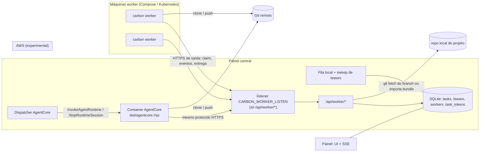

# Execução distribuída — workers remotos e AWS AgentCore

Por padrão o Carbon roda **uma tarefa por vez, na máquina do painel**. A execução distribuída permite rodar tarefas em outras máquinas (Docker Compose ou Kubernetes) e, de forma experimental, no **AWS Bedrock AgentCore Runtime**. O painel continua sendo o ponto central: fila, estado, log ao vivo, diff, perguntas, permissões e entrega aparecem nele como numa tarefa local.

> **AgentCore — Experimental.** Veja [agentcore.md](agentcore.md).

## Índice

| Documento | Para quê |
| --- | --- |
| [distributed-task.md](distributed-task.md) | Uma tarefa dividida em partes que rodam em vários computadores e voltam num PR só |
| [cluster-join.md](cluster-join.md) | Colocar servidores no cluster com um comando (estilo Docker Swarm), pausar e remover nós |
| [quickstart.md](quickstart.md) | Do zero a 2 workers rodando: na mesma máquina e em outra |
| [direct-join.md](direct-join.md) | `carbon join <ip>:<porta>`: o join do cluster pela rede local ou IP público, sem servidor nem domínio (certificado próprio + fingerprint) |
| [docker-compose.md](docker-compose.md) | Kit Compose: arquivos, variáveis, escala, atualização, logs, revogação |
| [kubernetes.md](kubernetes.md) | Kit Kubernetes: manifests, Secret, escala, rollout, revogação |
| [agentcore.md](agentcore.md) | AgentCore Runtime (experimental): kit, `deploy.sh`, IAM, configuração, custos, limites |
| [exposing-the-panel.md](exposing-the-panel.md) | `CARBON_WORKER_LISTEN`, TLS (autoassinado ou seu), Tailscale, Cloudflare Tunnel, `panelPublicUrl` |
| [protocol.md](protocol.md) | Referência da API `/api/worker/*` para escrever um worker próprio |
| [security.md](security.md) | Modelo de ameaça, tokens, isolamento de ambiente, `CARBON_GIT_HOSTS`, revogação |
| [operations.md](operations.md) | Frota, status, lease, reinício do painel, cancelamento, permissões e perguntas remotas |
| [environment.md](environment.md) | Referência completa de variáveis de ambiente e configurações |
| [troubleshooting.md](troubleshooting.md) | Sintoma → causa → correção, a partir das mensagens reais |
| [faq.md](faq.md) | Perguntas frequentes |

Versão web (mesmo conteúdo, resumido e navegável): <https://carbon-superagent.vercel.app/docs.html>.

## Três lugares para rodar uma tarefa

Cada tarefa tem um **runtime** (onde roda), escolhido no seletor **Onde rodar** ao criar a tarefa. Ele é independente do **executor** (qual CLI: Claude Code ou Codex).

| Runtime | Rótulo na UI | Quem executa | Quando fica disponível |
| --- | --- | --- | --- |
| `local` (padrão) | Esta máquina | O próprio processo do painel, uma tarefa por vez (fila serial) | Sempre |
| `pool` | Pool de workers | Qualquer processo `carbon worker` (ou `carbon join`) cadastrado que pegar a tarefa | Existe ao menos uma máquina não revogada em *Configurações → Máquinas* |
| `agentcore` | AgentCore (experimental) | Um container do AgentCore Runtime invocado pelo painel, uma sessão por tarefa | AgentCore ativado, ARN do runtime, URL pública do painel e credenciais AWS na máquina do painel |

Quando um runtime não está disponível, a opção aparece desabilitada no seletor com o motivo (ex.: "nenhuma máquina worker cadastrada (Configurações → Máquinas)").

Com `runtime = local`, o comportamento é o mesmo de antes da execução distribuída.

## Arquitetura

Pontos que valem para os dois runtimes remotos:

- **O worker puxa.** Toda conexão sai do worker para o painel (HTTPS). O painel nunca abre conexão para o worker. Por isso o painel precisa de uma URL alcançável (túnel ou VPN), mas a máquina worker não precisa de porta aberta.
- **O painel monta tudo.** Prompt, skills, mapa do projeto, memória e regras de permissão vão prontos no *claim*. O worker não acessa o banco do painel.
- **Mesmo redutor de eventos.** Os eventos do agente (texto, ferramentas, plano, uso, perguntas, pedidos de permissão) chegam ao painel em lotes e passam pelo mesmo código que trata uma tarefa local.
- **Lease.** Quem pega a tarefa recebe um *lease* (padrão 60 s) e o renova com heartbeats. Lease vencido → a tarefa falha com "worker … parou de responder" (ou volta à fila, se configurado). Ver [operations.md](operations.md).
- **Transporte de código.** Se o repositório do projeto tem `origin` e o branch base existe no remoto, o worker clona do remoto e faz push do branch `agent/*` (`git`). Caso contrário (sem remoto, sem commits, base só local), o worker baixa um `git bundle` do painel e devolve outro bundle com o commit (`bundle`). Push recusado cai para bundle automaticamente.
- **Entrega igual à local.** Quando o branch chega ao repositório do painel, "Aplicar na pasta", "Merge local" e "Abrir PR" funcionam como numa tarefa local.

## Peças no código

| Peça | Arquivo |
| --- | --- |
| Contrato do protocolo (schemas zod, versão) | `src/shared/worker-protocol.ts` |
| Rotas do worker | `src/app/api/worker/**` |
| Autenticação de máquina e token de tarefa | `src/server/auth/worker-auth.ts` |
| Fila, claim atômico, lease, sweep | `src/server/runner/scheduler.ts` |
| Montagem do claim (prompt, transporte) | `src/server/runner/prepare-claim.ts` |
| Importação do resultado (fetch / bundle) | `src/server/runner/remote-delivery.ts` |
| Worker (loop, execução, git, cliente HTTP) | `src/worker/*.ts` → `dist/worker.mjs` |
| Entrypoint do container AgentCore | `src/worker/agentcore-entry.ts` → `dist/agentcore.mjs` |
| Dispatcher AgentCore | `src/server/runtimes/agentcore.ts` |
| Listener público só de `/api/worker/*` | `bin/worker-proxy.mjs` |
| Geradores de kit (Compose, K8s, AgentCore) | `src/server/setup-kit/*.ts` |
| CLI `carbon worker` / `carbon worker init` | `bin/carbon.mjs`, `bin/worker-init.mjs` |
| Imagem do worker | `deploy/worker/Dockerfile` |
| E2E com painel real, 2 workers e AgentCore local | `scripts/e2e-distributed.mjs` (`npm run e2e:distributed`) |

## O que fica de fora

- Autoscaling por tamanho de fila (KEDA/HPA): não existe endpoint de métrica; a escala é manual (`--scale`, `replicas`).
- Vários painéis centrais / multi-tenant.
- Rodar o próprio painel na nuvem: só a exposição de `/api/worker/*` é documentada.
- Geração de descrição por IA e indexador da base de conhecimento continuam rodando no painel.
