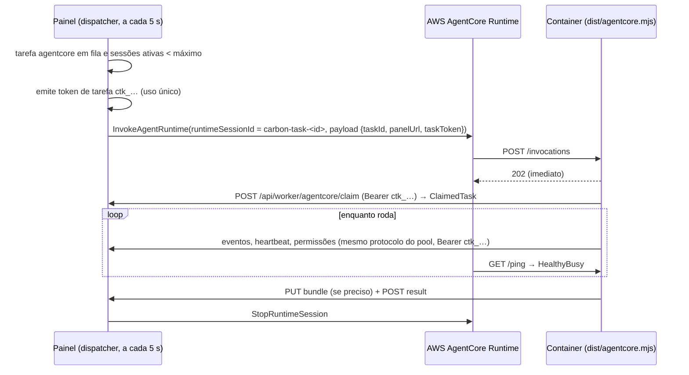

# AgentCore Runtime (experimental)

> **Experimental — não validado em conta AWS real.** O dispatcher do painel, o entrypoint do container e o kit de deploy foram testados só localmente: SDK da AWS mockado nos testes unitários e, no E2E (`npm run e2e:distributed`), o container rodando na máquina com um endpoint falso da API do AgentCore. Nada foi implantado na AWS pelo projeto. Valide numa conta de teste antes de usar com código real.

Com o runtime **AgentCore**, cada tarefa roda numa sessão do AWS Bedrock AgentCore Runtime na **sua** conta AWS. O container usa o mesmo protocolo dos workers de pool; o painel só invoca a sessão e depois a encerra.

## Como funciona



- `runtimeSessionId` é determinístico: `carbon-task-<id da tarefa>`, completado com `0` até 33 caracteres (mínimo do AgentCore).
- O painel **não lê** o stream de resposta do Invoke (ele fecha em 60 min; o Invoke síncrono em 15 min). Todo progresso vem pelo protocolo HTTPS de saída do container.
- O token de tarefa é queimado no claim e depois só autentica as rotas `/api/worker/tasks/<essa tarefa>/*`, enquanto a tarefa roda ou espera sob o lease do AgentCore. Validade: o tempo máximo da tarefa (`maxRunMinutes`) + 30 min, limitada a 8 h.
- Invoke que falha é tentado mais 3 vezes (backoff 1 s, 2 s, 4 s). Depois disso a tarefa falha com `AgentCore: falha ao invocar o runtime após 4 tentativas — <erro resumido do SDK>`.
- Ao terminar (done, failed, canceled), o painel revoga os tokens da tarefa e chama `StopRuntimeSession`. Se o Stop falhar, a sessão cai sozinha pelo timeout de ociosidade (15 min por padrão).
- Cancelar uma tarefa AgentCore antes do claim encerra a sessão na hora.
- Um container atende uma tarefa: outra tarefa recebe `409 container ocupado com outra tarefa`; a mesma tarefa de novo recebe `202` (o AgentCore pode repetir a invocação).

## Pré-requisitos

- Conta AWS com acesso ao Bedrock AgentCore Runtime na região escolhida (padrão `sa-east-1`).
- Na máquina que vai fazer o deploy: AWS CLI v2 com `bedrock-agentcore-control`, Docker com `buildx` (build `linux/arm64`), `jq`, e o repositório do Carbon na mesma versão do painel.
- Painel com `/api/worker/*` exposto por **HTTPS** público ([exposing-the-panel.md](exposing-the-panel.md)) e a URL pública configurada.
- Na máquina do painel: credenciais AWS na cadeia padrão do SDK (`AWS_PROFILE`, SSO, `~/.aws/credentials|config`, variáveis `AWS_ACCESS_KEY_ID`/`AWS_SECRET_ACCESS_KEY`, web identity ou credenciais de container). O Carbon não guarda chave AWS.

## Kit

Gere de um destes jeitos (nenhum executa nada na AWS; o kit não contém token):

- UI: *Configurações → Execução → Workers e AgentCore → Kit AgentCore (experimental)* (usa a região e a URL pública salvas);
- CLI: `node bin/carbon.mjs worker init --target agentcore --out ./carbon-agentcore --panel-url https://workers.exemplo.com --region sa-east-1`.

| Arquivo | Conteúdo |
| --- | --- |
| `Dockerfile` | `linux/arm64`, Node 22, git, Claude Code em versão fixa, usuário `node`, `PORT=8080`, `CARBON_WORKER_DIR=/home/node/work`, `CARBON_WORKER_GRACE_SECONDS=60`, `CMD node /opt/carbon/agentcore.mjs` |
| `iam-policy.json` | Política mínima da role de execução: pull no ECR do repositório do kit, `ecr:GetAuthorizationToken`, logs em `/aws/bedrock-agentcore/runtimes/*` |
| `deploy.sh` | Cria o repositório ECR se faltar, build arm64 e push, cria ou atualiza o runtime, imprime o ARN |
| `README.md` | Riscos abertos e passo a passo |

## Deploy

1. **Role de execução** com trust policy para `bedrock-agentcore.amazonaws.com` (condição `aws:SourceAccount` = sua conta) e `iam-policy.json` anexada (troque `<ACCOUNT_ID>`). Com `CLAUDE_CODE_USE_BEDROCK=1`, acrescente `bedrock:InvokeModel` e `bedrock:InvokeModelWithResponseStream` **só** nos modelos usados.
2. **Build do entrypoint**, na raiz do Carbon: `npm run build:worker` (gera `dist/agentcore.mjs`).
3. **Deploy**, na raiz do Carbon:

   ```sh
   ACCOUNT_ID=<ACCOUNT_ID> \
   ROLE_ARN=arn:aws:iam::<ACCOUNT_ID>:role/<ROLE_NAME> \
   CARBON_PANEL_URL=https://workers.exemplo.com \
   CLAUDE_CODE_USE_BEDROCK=1 \
   bash ./carbon-agentcore/deploy.sh
   ```

   Variáveis do `deploy.sh`: `ACCOUNT_ID` e `ROLE_ARN` (obrigatórias), `REGION` (padrão `sa-east-1`), `RUNTIME_NAME` (`carbon_worker`), `REPOSITORY` (`carbon-agentcore`), `IMAGE_TAG` (hash curto do HEAD), `CARBON_PANEL_URL`, `IDLE_TIMEOUT_SECONDS` (900), `MAX_LIFETIME_SECONDS` (28800, teto), `CLAUDE_CODE_USE_BEDROCK`, `ANTHROPIC_API_KEY`, `CARBON_GIT_TOKEN`. O runtime é criado com `networkMode: PUBLIC`.

4. **Configure o painel** em *Configurações → Execução → Workers e AgentCore*:

   | Campo | Valor |
   | --- | --- |
   | AgentCore disponível no seletor "Onde rodar" | ligado |
   | Região AWS | a mesma do deploy |
   | ARN do runtime | o ARN impresso (`arn:aws:bedrock-agentcore:<região>:<conta>:runtime/<id>`) |
   | Qualifier (endpoint) | `DEFAULT` quando não há endpoint próprio |
   | Sessões simultâneas (máx.) | 1–20, padrão 3 (controle de custo) |

   O seletor **Onde rodar** passa a oferecer **AgentCore (experimental)**. Faltando algo, a opção fica desabilitada com o motivo: AgentCore desativado, ARN ausente, URL pública ausente ou credenciais AWS não encontradas na máquina do painel.

## Variáveis do container

| Variável | Obrigatória | Padrão | Efeito |
| --- | --- | --- | --- |
| `CARBON_PANEL_URL` | sim | — | URL `https://` do painel (IP privado literal é recusado). O container não sobe sem ela e recusa invocações cujo `panelUrl` tenha outra origem (`403`) |
| `PORT` | não | `8080` | Porta HTTP (contrato do AgentCore: 8080) |
| `CARBON_WORKER_DIR` | não | `/home/node/work` (imagem) | Pasta dos clones |
| `CARBON_WORKER_GRACE_SECONDS` | não | `60` (imagem) | Espera pela tarefa ao receber SIGTERM |
| `CARBON_GIT_TOKEN` / `CARBON_GIT_HOSTS` | não | — | Token git e hosts para os quais ele pode ser enviado |
| `CLAUDE_CODE_USE_BEDROCK` + `AWS_REGION` | uma das duas opções | — | Claude Code via Bedrock, com a role (recomendado) |
| `ANTHROPIC_API_KEY` | uma das duas opções | — | Claude Code via API da Anthropic |

O container usa só o Claude Code (a imagem não instala Codex).

## Custos e limites

- Você paga a sessão do AgentCore enquanto ela existe (inclusive esperando resposta de permissão) e as chamadas ao modelo. Por isso há o limite de **sessões simultâneas** (padrão 3); sessões esperando permissão contam no limite.
- **8 h por sessão** é o teto do AgentCore (`maxLifetime` ≤ 28800 s). No Carbon, o tempo máximo de uma tarefa (`maxRunMinutes`) vai de 5 a 240 min, então a tarefa estoura o limite do Carbon antes: falha com `tempo limite (N min) atingido`.
- Ociosidade: sessão sem tarefa cai em `IDLE_TIMEOUT_SECONDS` (900 s padrão).
- Sem retomada de sessão do Claude entre execuções: uma pergunta do agente encerra a execução e a resposta recomeça a tarefa com as decisões no prompt ([operations.md](operations.md#perguntas-do-agente-em-execução-remota)).

## Riscos abertos (validar numa conta de teste)

1. **Egress** no modo `PUBLIC`: o container precisa alcançar o painel, o remoto git e a API do modelo por HTTPS.
2. **Login do Claude Code** sem navegador: `CLAUDE_CODE_USE_BEDROCK=1` (pela role) ou `ANTHROPIC_API_KEY`. Custo e termos de cada opção precisam de validação interna.
3. **Tipo do stream** de resposta do `InvokeAgentRuntimeCommand` no SDK JS: o Carbon só fecha o stream sem ler.
4. **Parâmetros da CLI** `create-agent-runtime`/`update-agent-runtime` seguem a documentação pública e podem mudar: confira com `aws bedrock-agentcore-control help`.
5. **Formato do `/ping`** (`{status, time_of_last_update}`): baseado na documentação, não exercitado na AWS.

## Segurança específica

- Prefira **Bedrock via IAM role** para o modelo. `ANTHROPIC_API_KEY` e `CARBON_GIT_TOKEN` passados por `--environment-variables` ficam visíveis para quem tem `GetAgentRuntime` na conta. Se precisar de token git, avalie guardar no **Secrets Manager** e restringir quem lê a configuração do runtime (o Carbon não lê Secrets Manager hoje; isso exigiria mudança no container).
- Logs do agente no CloudWatch podem conter código e segredos do repositório: mesma política de acesso do repositório.
- Mais em [security.md](security.md).
