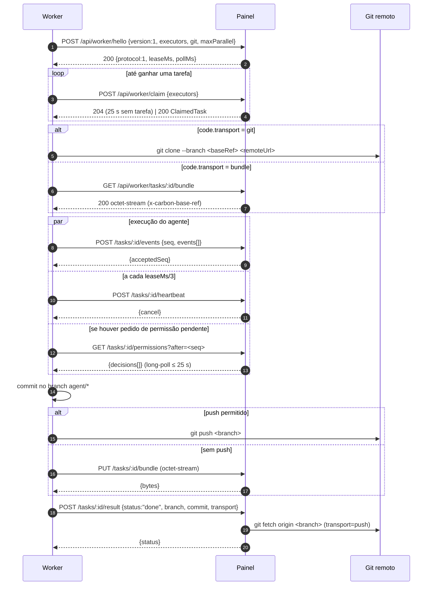

# Protocolo de worker — referência da API `/api/worker/*`

Referência para quem quer escrever um worker próprio. A fonte da verdade são os schemas zod de `src/shared/worker-protocol.ts` (compartilhados pelo painel e pelo worker oficial em `src/worker/`). **Versão do protocolo: 1** (`PROTOCOL_VERSION`).

## Convenções

- **Base:** a URL pública do painel (`panelPublicUrl`) ou, na mesma máquina, `http://127.0.0.1:3417`. HTTPS obrigatório fora de loopback.
- **Autenticação:** `Authorization: Bearer <token>` em toda rota.
  - Worker de pool: `cwk_` + 43 caracteres base64url (token da máquina).
  - Container AgentCore: `ctk_` + 43 caracteres (token de tarefa, uso único no claim; depois só vale nas rotas da própria tarefa).
- **Corpo JSON:** `Content-Type: application/json`, no máximo **1 MB** (`MAX_JSON_BODY_BYTES`); corpo vazio vale como `{}`.
- **Envelope de resposta JSON:** `{ "success": boolean, "data": T | null, "error": string | null }`. Exceções: `204` sem corpo no claim e o corpo binário do `GET …/bundle`.
- **Sem cookie e sem checagem de origem:** o middleware deixa `/api/worker/` passar; cada handler autentica pelo Bearer.
- **Tarefa inexistente** e **tarefa de outro worker** dão a mesma resposta (`409 lease_lost`) depois da autenticação: o painel não revela se a tarefa existe.

## Códigos de status

| Status | Quando | O que o worker deve fazer |
| --- | --- | --- |
| `200` | OK | — |
| `204` | Claim sem tarefa dentro do long-poll | Chamar claim de novo |
| `400` | JSON inválido, campo fora do schema (`<campo>: <motivo>`), `after` inválido, bundle vazio; no listener, query string fora do padrão simples | Erro de programação: não repetir igual |
| `408` | Listener: requisição passou de 60 s (30 min nas rotas de bundle) | Repetir |
| `401` | Token ausente, malformado, desconhecido, revogado, expirado ou fora do escopo. Mensagem sempre `não autenticado` (no listener, sem corpo) | Parar (o oficial sai com código 1) |
| `403` | Container AgentCore: `panelUrl` da invocação diferente do `CARBON_PANEL_URL` fixado (`panelUrl não autorizada neste container`) | Parar |
| `409` | `error = "lease_lost"`: o worker não é mais dono da tarefa (lease vencido, tarefa reatribuída, cancelada, inexistente). No claim do AgentCore: `tarefa indisponível para esta sessão` | Matar o agente e descartar a tarefa, sem reportar |
| `413` | Corpo JSON > 1 MB; bundle > `workers.maxBundleMb` (`resultado maior que N MB`); eventos que deixariam o estado da tarefa > 4 MB (`estado da tarefa grande demais`) ou com mais de 50 pedidos de permissão pendentes (`mais de 50 pedidos de permissão pendentes`) | Não repetir; reportar `failed` |
| `422` | `GET bundle`: não foi possível gerar o bundle da base. `POST result` com `done`: o painel não conseguiu importar o branch (a tarefa já foi marcada `failed` com o motivo) | Não repetir |
| `426` | `hello` com `version` menor que o protocolo do painel | Atualizar o worker (o oficial sai com código 2) |
| `429` | Rate limit: `muitas requisições; reduza a frequência` (600/min por token); `muitas consultas simultâneas deste worker; aguarde as anteriores` (mais de `max(maxParallel, 1) + 1` long-polls de claim ou de permissões abertos ao mesmo tempo); `muitas tentativas; aguarde 15 minutos` (falhas de autenticação repetidas com o mesmo token, ou 50 por IP) | Backoff e repetir |
| `5xx`, `408`, erro de rede | Painel indisponível | Backoff exponencial com jitter e repetir (o oficial: base 500 ms, teto 30 s) |

## Lease, heartbeat e `seq`

- **Lease:** o claim dá ao worker a posse da tarefa por `leaseMs` (configuração `workers.leaseMs`, padrão 60 000 ms, 10 s–10 min). Cada heartbeat renova. Lease vencido é varrido a cada 15 s: a tarefa vira `failed` com `worker <nome> parou de responder (<hora>) — use “rodar de novo”`, ou volta para `queued` se `workers.requeueOnLeaseLoss = true`.
- **Heartbeat:** envie a cada `leaseMs / 3` (o oficial usa `max(1 s, leaseMs/3)`). A resposta traz `cancel: true` quando o usuário cancelou: mate o agente e reporte `canceled`.
- **`seq` dos eventos:** número do lote, monotônico **por execução** (o claim zera o contador no painel), começando em 1. Lote com `seq` ≤ último aceito é ignorado e responde o `acceptedSeq` atual — reenviar após timeout é seguro. Lacunas são aceitas. Envie em ordem e espere o ack antes do próximo lote.
- **Ordem:** o resultado deve ser enviado depois que todos os lotes de eventos foram confirmados (o oficial espera até 60 s e envia o resultado mesmo assim).

## Sequência completa (pool)



## Rotas

### `POST /api/worker/hello`

Handshake. Registra capacidades e versão do worker (aparecem na frota).

```json
{ "version": 1, "executors": ["claude", "codex"], "git": true, "maxParallel": 2, "workerVersion": "0.2.0+p1" }
```

| Campo | Tipo | Regra |
| --- | --- | --- |
| `version` | inteiro ≥ 0 | Versão de protocolo do worker; < 1 → `426` |
| `executors` | `("claude"\|"codex")[]` | até 2; padrão `[]` |
| `git` | boolean | O worker tem credencial git (informativo); padrão `false` |
| `maxParallel` | inteiro 1–64 | padrão 1 |
| `workerVersion` | string ≤ 200 | opcional; exibida em "Versão" |

Resposta `200`: `{ "protocol": 1, "leaseMs": 60000, "pollMs": 25000 }`.

### `POST /api/worker/claim`

Long-poll (até 25 s) pela próxima tarefa `pool` em fila. Cada worker pode ter no máximo `max(maxParallel, 1) + 1` claims abertos ao mesmo tempo (`maxParallel` do `hello`), na ordem da fila, cujo executor esteja em `executors`. Claim é atômico (`UPDATE … WHERE status = 'queued'` sob `BEGIN IMMEDIATE`): duas chamadas concorrentes nunca recebem a mesma tarefa. Se a conexão cair, a espera termina.

Corpo: `{ "executors": ["claude"] }` (1 a 2 itens). Resposta `204` sem tarefa, ou `200` com `ClaimedTask`:

```json
{
  "taskId": "8f0c…",
  "key": "CAR-42",
  "title": "Corrigir paginação da lista de pedidos",
  "leaseMs": 60000,
  "executor": "claude",
  "model": { "model": "sonnet", "effort": "medium", "label": "Sonnet · médio", "reason": "…" },
  "prompt": "…prompt completo montado pelo painel…",
  "resume": null,
  "code": { "transport": "git", "remoteUrl": "https://github.com/org/repo.git", "baseRef": "main", "branch": "agent/car-42-…" },
  "limits": { "maxRunMinutes": 45 },
  "permissionRules": [{ "tool": "Bash", "pattern": "npm test" }],
  "settings": { "permissionProfile": "guarded", "isolateClaudeConfig": true, "approvalPolicy": "smart" },
  "files": [{ "path": ".carbon/PROJECT_MAP.md", "content": "…" }]
}
```

| Campo | Significado |
| --- | --- |
| `code` | `{transport:"git", remoteUrl, baseRef, branch}` — clone do remoto (credenciais embutidas na URL do remoto são removidas pelo painel) — ou `{transport:"bundle", baseRef, branch, bundleUrl}` — baixe `bundleUrl` (caminho relativo ao painel). `baseRef` = `(sem commits)` quando o repositório não tinha commits |
| `branch` | Branch a criar e entregar (`agent/<…>`). O painel recusa resultado com outro branch |
| `resume` | `{decisions: string[]}` quando a tarefa volta de uma pergunta respondida; as decisões já estão no `prompt` |
| `permissionRules` | Regras "sempre neste repositório" já resolvidas |
| `settings` | Perfil de permissão, isolamento da config do Claude e política de aprovação, para montar o comando da CLI |
| `files` | Arquivos de contexto (skills, `.carbon/PROJECT_MAP.md`, memória) a escrever no clone antes de rodar; caminhos relativos sem `..`. **Não** entram no commit (`.claude/skills/carbon-*/`, `.codex/skills/carbon-*/`, `.carbon/`) |
| `limits.maxRunMinutes` | Tempo máximo do agente; estourou → `failed` com `tempo limite (N min) atingido` |

Se o painel não conseguir preparar uma tarefa (projeto removido etc.), ela é marcada `failed` e o long-poll continua.

### `POST /api/worker/agentcore/claim`

Só para containers AgentCore. Bearer = token de tarefa `ctk_…` recebido no payload do Invoke. Corpo: `{ "taskId": "8f0c…" }`. Queima o token (uso único; dois usos concorrentes não passam) e devolve o mesmo `ClaimedTask`. `401` para token desconhecido, reutilizado, expirado ou de outra tarefa; `409 tarefa indisponível para esta sessão` se a tarefa foi cancelada, já pega ou o projeto sumiu.

Depois do claim, o mesmo `ctk_…` autentica **só** `/api/worker/tasks/<taskId>/*` dessa tarefa, enquanto ela estiver `running`/`waiting` sob o lease do AgentCore e dentro da validade do token.

### `POST /api/worker/tasks/:id/heartbeat`

Corpo vazio. `200 {"cancel": false}` renova o lease. `409 lease_lost` se não é mais dono.

### `POST /api/worker/tasks/:id/events`

```json
{ "seq": 3, "events": [ { "type": "text", "text": "Lendo o módulo de paginação…" } ] }
```

Até 500 eventos por lote e 1 MB por corpo. O painel recusa (`413`) lotes que deixariam o estado da tarefa acima de 4 MB ou com mais de 50 pedidos de permissão pendentes. Resposta: `{ "acceptedSeq": 3 }`. Tipos de evento (`ExecutorEvent`, textos até 64 000 caracteres):

| `type` | Campos |
| --- | --- |
| `session` | `sessionId`, `model` (string ou `null`) |
| `text` / `thinking` | `text` |
| `tool` | `name`, `summary`, `path` (ou `null`) |
| `plan` | `items: {text, done}[]` (até 200) |
| `usage` | `tokens` ≥ 0, `costUsd` ≥ 0 ou `null` |
| `result` | `isError`, `text` |
| `error` | `message` |
| `permission_request` | `requestId`, `tool`, `summary`, `detail`, `input`, `suggestions[]` (até 50) |
| `permission_denied` | `tool`, `message` |

Os marcadores do protocolo de progresso (`CARBON_STAGE`, `CARBON_PLAN`, `CARBON_QUESTION`, `CARBON_OPTION`…) vão dentro de eventos `text`, como a CLI os imprime; o painel os interpreta.

O worker oficial guarda até 5 MB de eventos não confirmados por tarefa; acima disso descarta primeiro `text`/`thinking`, depois `tool`, mais antigos primeiro.

### `GET /api/worker/tasks/:id/bundle`

Só para o dono do lease. Resposta `200 application/octet-stream`: `git bundle` com o commit base, cabeçalho `x-carbon-base-ref` com a ref a usar. Repositório sem commits: o bundle traz um snapshot dos arquivos como base. `422` se o bundle não puder ser gerado (`o repositório do projeto não é um repositório git: …`, `git bundle create falhou: …`).

### `PUT /api/worker/tasks/:id/bundle`

Upload do resultado: corpo bruto `application/octet-stream` com um `git bundle` contendo o branch da tarefa. Limite `workers.maxBundleMb` (padrão 200 MB, máx. 2000) → `413 resultado maior que N MB`. Corpo vazio → `400 bundle vazio`. Resposta `{ "bytes": 12345 }`. Envie **antes** do `result` com `transport: "bundle"`.

### `GET /api/worker/tasks/:id/permissions?after=<seq>`

Long-poll (até 25 s) das respostas humanas aos `permission_request` que o worker enviou. `after` = maior `seq` de decisão já lida (inteiro ≥ 0). Resposta:

```json
{ "decisions": [ { "seq": 1, "requestId": "req-7", "behavior": "allow", "message": null, "allowTask": false, "rule": { "tool": "Bash", "pattern": "npm install" } } ] }
```

- `behavior`: `allow` ou `deny` (com `message` para o agente).
- `allowTask: true`: "liberar tudo nesta tarefa" — aprove sozinho os próximos pedidos.
- `rule`: "sempre neste repositório" — acrescente às regras locais. Para comandos de shell, interpretador ou rede (`bash`, `python`, `node`, `curl`, `ssh`, `sudo`…) o painel rebaixa a resposta para "permitir uma vez" e manda `rule: null`.
- Pedido sem resposta além de `permissionTimeoutMinutes` (padrão 15) é negado pelo próprio painel e aparece aqui como `deny`.

### `POST /api/worker/tasks/:id/result`

```json
{ "status": "done", "branch": "agent/car-42-…", "commit": "3f9a1c…", "transport": "push" }
```

| Campo | Regra |
| --- | --- |
| `status` | `done`, `failed`, `canceled` ou `waiting` (o agente fez uma `CARBON_QUESTION`; nada é entregue) |
| `branch` | O `branch` do claim |
| `commit` | SHA do commit entregue, ou `null` quando o agente não alterou arquivos |
| `transport` | `push` (o painel faz `git fetch origin <branch>`) ou `bundle` (usa o bundle do `PUT`) |
| `error` | Opcional, até 4000 caracteres; aparece no log da tarefa |

O painel libera o lease, importa o branch (verificando que aponta para `commit`, sem sobrescrever um branch local divergente nem um branch em uso num worktree) e segue a entrega como numa tarefa local. Resposta `{ "status": "done" }`. Com `status: "done"` e importação falha: `422` com o motivo (a tarefa já foi marcada `failed`).

## Escrevendo um worker próprio — checklist

1. `hello` com `version: 1`; trate `426`.
2. Loop de `claim` (long-poll); repita em `204`.
3. Prepare o código (clone com `--branch <baseRef>` ou bundle), crie `branch`, escreva `files`.
4. Rode o agente; envie eventos em lotes com `seq` crescente; heartbeat a cada `leaseMs/3`; obedeça `cancel`.
5. Encaminhe `permission_request` que não casam com `permissionRules` e faça long-poll de `permissions`.
6. Commit (sem os arquivos de contexto), push ou `PUT bundle`, `result`.
7. Em `409 lease_lost` a qualquer momento: pare e descarte.
8. Nunca registre o token em log.

O worker oficial (`src/worker/client.ts`, `run-task.ts`, `loop.ts`) é a implementação de referência e tem testes contra as rotas reais (`src/server/runner/worker-api.test.ts`).
